# HealthGen agentic solution

The server side of the HealthGen care assistant. This repo has everything behind the embeddable **Agentic Client Widget** (separate `agent-widget` repo): Direct Line, the Agent relay, the identity broker, Foundry agents, MCP tools, plan search, APIM policies and the n8n hand-off.

```mermaid
flowchart LR
  subgraph Portals
    W["agent-widget<br/>(member / provider portal)"]
    BFF["Portal backend (BFF)"]
  end
  W -- "token request" --> BFF
  BFF -- "portal assertion" --> IB["Identity broker"]
  IB -- "tokens/generate (secret)" --> DL["Azure Bot Service<br/>Direct Line"]
  W <-- "Direct Line 3.0" --> DL
  DL --> R["Agent relay<br/>M365 Agents SDK (Python)"]
  R -- "resolve session, confirm actions" --> IB
  R -- "Responses API + X-User-Context" --> APIM1["APIM: agent gateway"]
  APIM1 --> T["Foundry: triage agent"]
  T -- "A2A 1.0" --> BC["Foundry: benefit check"]
  T -- "A2A 1.0" --> FAQ["Foundry: plan FAQ"]
  BC --> S["Azure AI Search<br/>plan documents"]
  FAQ --> S
  BC -- "MCP" --> APIM2["APIM: MCP gateway"]
  T -- "MCP (hand-off only)" --> APIM2
  APIM2 --> MCP["HealthGen MCP data spoke"]
  MCP -- "RFC 8693 token exchange" --> IB
  MCP -- "member-scoped JWT" --> CORE["HealthGen core<br/>(mock in this repo)"]
  MCP -- "signed webhook" --> N8N["n8n hand-off → care team"]
  R -- "card data" --> MCP
```



## What each part does

| Path | Component | Notes |
| --- | --- | --- |
| `services/agent-relay` | Agent relay | Python on the **Microsoft 365 Agents SDK** (`host_m365.py`). It turns Direct Line activities into Foundry turns and turns the agents' replies into messages, Adaptive Cards, suggested actions and navigate/hand-off events. It also contains `dev_server.py`, a local Direct Line 3.0 emulator. |
| `services/identity-broker` | Identity broker | Binds the Direct Line user to the portal user, issues the user-context JWT that APIM checks, holds pending write actions (human in the loop), and does the RFC 8693 token exchange. Signs with a Key Vault HSM key in Azure. |
| `services/mcp-healthgen` | MCP data spoke | 12 tools on MCP SDK 2.x, Streamable HTTP. Every tool takes `session_ref` and never a member id. Writes are two-step: prepare, then submit after the user confirms. It also stores the card data the relay renders. |
| `services/healthgen-core-mock` | HealthGen core mock | Synthetic members, plans, benefits, accumulators, providers, slots, referrals and prior-auth rules. It validates the broker's downstream JWT and the one-time confirmation. Replace it with the real core APIs. |
| `agents/` | Foundry agents (declarative YAML) | `triage`, `benefit-check` and `plan-faq` prompt agents, the project connections, and `deploy_agents.py`. |
| `search/` | Plan documents | Synthetic SBC/EOC documents, the index schema and `ingest.py`. |
| `apim/` | APIM policies | Agent gateway (relay → Foundry) and MCP gateway (Foundry → MCP). |
| `handoff/` | n8n workflow | Checks the webhook signature, creates a ticket, notifies the care team and returns the ticket ref. |
| `services/foundry-local`, `clients/portal-dev` | Local stand-ins | A scripted Foundry and APIM stand-in (not an LLM), plus a portal host page and BFF sample, so the whole stack runs on a laptop. |

Design notes: [architecture](docs/architecture.md) · [identity and security](docs/identity-and-security.md) · [deployment runbook](docs/deployment-runbook.md) · [operations](docs/operations.md) · [agents](agents/README.md)

## Run it locally

You need Python 3.11+ and the packages in the services' `requirements.txt`. No Azure is needed.

```bash
pip install -r services/mcp-healthgen/requirements.txt -r services/identity-broker/requirements.txt pyyaml
python scripts/local_stack.py          # starts 6 processes
# open http://localhost:8080, then switch between Alex (HMO), Jordan (PPO) and Dr. Raman (provider) in the header
```

The page loads a vendored build of the widget (`clients/portal-dev/vendor`). To use your own build, set `WIDGET_DIST=../agent-widget/dist`.

## Tests

```bash
for s in healthgen-core-mock identity-broker mcp-healthgen agent-relay; do (cd services/$s && python -m unittest discover -s tests); done
python -m unittest discover -s tests/e2e -v      # the full stack over HTTP, as the widget talks to it
python agents/deploy_agents.py --env-file agents/foundry.env.example --dry-run
```

There are 56 tests:

| Suite | Tests | What it covers |
| --- | --- | --- |
| Core mock | 12 | |
| Broker | 11 | Includes the Key Vault signer against a fake vault. |
| MCP | 9 | Uses the real MCP client and the real broker and core. |
| Relay | 19 | |
| End to end | 5 | Member booking, provider referral, role checks, hand-off, Direct Line token binding. |

## Not verified against Azure yet

These pieces were written against the documentation and could not be run in the build environment. Check them on the first deployment (the runbook flags each one):

- **M365 Agents SDK host (`host_m365.py`):** pin the package versions after the first install.
- **Incoming-A2A PATCH body in `deploy_agents.py`:** the docs page does not show the body. You can override it per agent with `a2a.enable_body`.
- **ARM `category`/`authType` of the MCP connection (`RemoteTool`, `ProjectManagedIdentity`):** if the API rejects them, use the `azd ai connection create` command in the runbook instead.
- **APIM policy expressions:** check them in the APIM policy editor on import.
- **Key Vault signer:** it is covered by tests against a fake vault but has not run against a real one.
