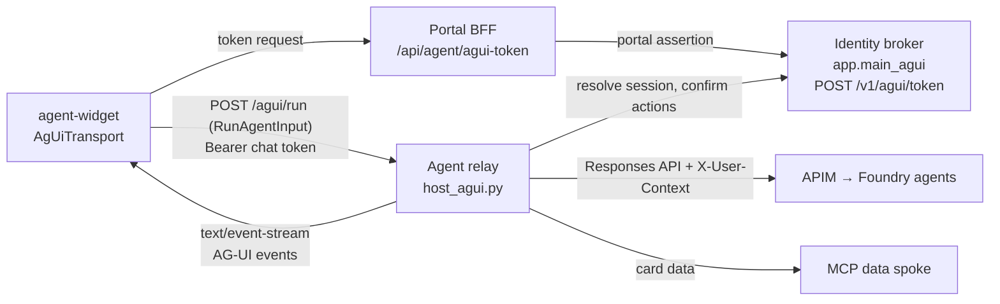
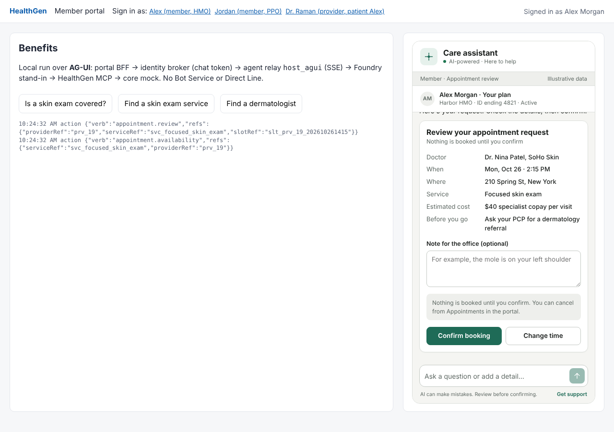
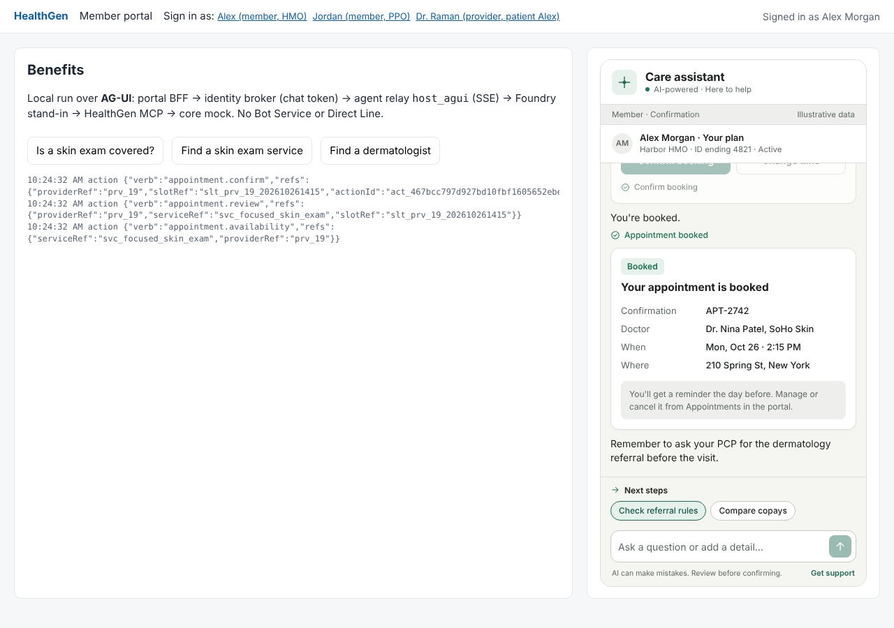
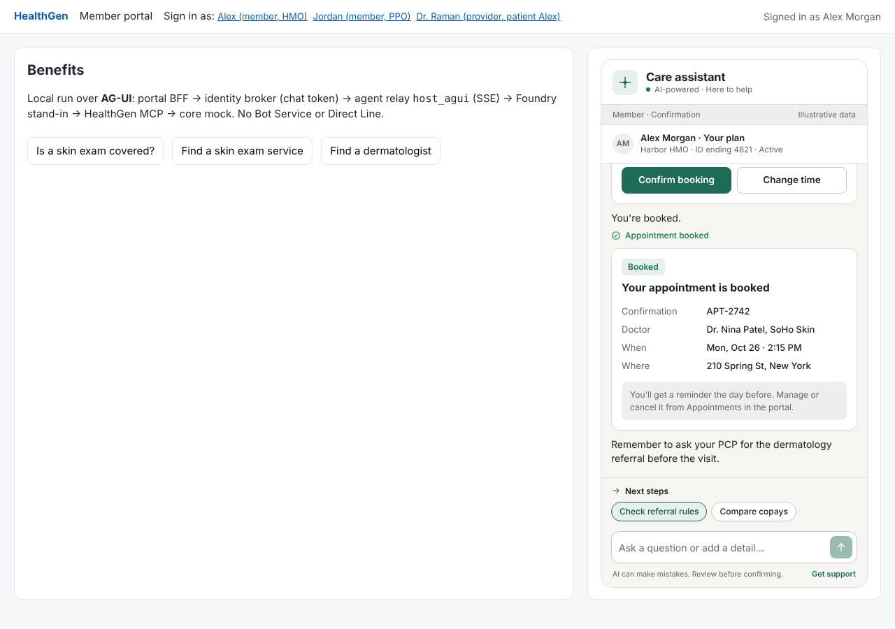

# AG-UI path (client and relay without Bot Service or Direct Line)

The widget can talk to the agent relay over the open [AG-UI protocol](https://docs.ag-ui.com) instead of Azure Bot Service and Direct Line. This path is **additive**:

- Every Direct Line file is unchanged: `host_m365.py`, `dev_server.py`, `app/main.py`, `DirectLineTransport`, `clients/portal-dev`, `scripts/local_stack.py`.
- The AG-UI path adds parallel entry points next to them.
- Both paths share the same relay core, broker, MCP spoke, Foundry agents and card templates.

The solution outline is the *AG-UI solution outline* doc. This page covers what was built, how to run it and how to deploy it.



## What was added

| Layer | New file | Role |
| --- | --- | --- |
| Widget | `clients/agent-widget/src/core/agui.ts` | `AgUiTransport`, a drop-in `Transport`. It maps widget activities to `RunAgentInput` and maps AG-UI events back to activities, so the UI, card renderer and events are unchanged. |
| Widget | `clients/agent-widget/src/index.ts` | Two added export lines. |
| Portal sample | `clients/portal-dev-agui/` | Host page and BFF. The only difference from `portal-dev` is `transport: () => new AgentWidget.AgUiTransport(...)` and the token route. |
| Broker | `app/agui.py`, `app/main_agui.py` | `POST /v1/agui/token` issues a chat token bound to one thread. `main_agui` is `main.create_app` plus that route, and works with Direct Line switched off. |
| Relay | `relay/agui.py`, `host_agui.py` | The AG-UI host: `POST /agui/run` (SSE) and `GET /agui/threads/{id}`. It runs the unchanged `RelayCore`. |
| Local run | `scripts/local_stack_agui.py` | The same stack with the AG-UI entry points and no Direct Line emulator. |
| Tests | `test_agui_tokens.py` (5), `test_agui.py` (8), `agui.test.ts` (8), `tests/e2e/test_local_stack_agui.py` (7) | |

The widget source now lives in this repo at `clients/agent-widget`. It is a copy of the standalone widget with `agui.ts` and the two exports added; the other widget files are identical.

## How the protocol maps onto the design

| Widget / design concept | AG-UI |
| --- | --- |
| User text | `messages`: the relay uses only the newest `user` message. History the client sends is ignored, so the client can't plant earlier turns. |
| Card button (`Action.Execute`) | `forwardedProps.action = {verb, data}`, checked by the same safe-action rules as Direct Line |
| Portal journey (`startJourney`) | `forwardedProps.journey = {id, params}` |
| "Talk to a person" | `forwardedProps.action = {verb: "handoff"}` |
| Page and locale hints | `context` entries `page` and `locale`. Member identity never comes from the client. |
| Typing / progress | `STEP_STARTED` / `STEP_FINISHED` |
| Bot text | `TEXT_MESSAGE_START` / `CONTENT` / `END` |
| Adaptive Card | `ACTIVITY_SNAPSHOT`, `activityType: "adaptive_card"`, `content: {templateId, card}`. The relay binds the template, exactly as for Direct Line. |
| Suggested replies, result chip | `ACTIVITY_SNAPSHOT` with `suggestions` / `result_chip` |
| Breadcrumb | `STATE_DELTA` on `/breadcrumb` |
| navigate, hand-off | `CUSTOM` events `navigate` and `handoff` |
| Review card (human in the loop) | The run ends with `RUN_FINISHED`, `outcome.type: "interrupt"`. The interrupt id is the broker's `act_…` id. |
| Confirm / Submit | The next run carries `resume: [{interruptId, status: "resolved", payload: {approved, note, attest}}]` |
| Anything else while a review is open | The widget sends that interrupt as `cancelled`. A run that leaves an interrupt unanswered gets `RUN_ERROR interrupt_pending`. |
| Page reload | `GET /agui/threads/{id}` returns the transcript, state and open interrupts (`features.history: true` in the widget) |

## What stays the same (security)

The AG-UI host is only a different front door to `RelayCore`, so every control on the Direct Line path still applies:

- **Who the user is** comes from the broker binding, never from the request. The chat token's `sub` is an opaque `agui_…` id, and `/v1/sessions/resolve` maps it to the portal principal, exactly like a Direct Line user id.
- **One token, one thread.** The token's `tid` must equal the request's `threadId` (else 403). Resuming another user's thread id through the BFF gives a new thread.
- **Card actions** go through the same verb allowlist and `SAFE_DATA` filtering. Free text in card inputs (office notes, clinical notes) goes to the broker's confirmation record, not to the model.
- **Writes** still need the broker's one-time, hash-checked confirmation. An approved resume is turned into the existing `appointment.confirm` / `referral.submit` action. A declined resume never reaches the broker. Replaying a resume gets `unknown_interrupt`.
- **Limits:** request bodies are capped at 64 KB, ids are validated, CORS allows only `AGUI_CORS_ORIGINS`, and errors never include internals (`RUN_ERROR relay_error`).

## Run it locally

```bash
pip install -r services/agent-relay/requirements-agui.txt   # plus the requirements in the README
python scripts/local_stack_agui.py                          # open http://localhost:8081
```

The Direct Line stack (`scripts/local_stack.py`, port 8080) still works and can run alongside it on another `--base`.

| Review card → interrupt | Booked after resume | Reload restores the thread |
| --- | --- | --- |
|  |  |  |

## Tests

```bash
(cd services/identity-broker && python -m unittest discover -s tests)   # 16, of which 5 AG-UI
(cd services/agent-relay && python -m unittest discover -s tests)       # 27, of which 8 AG-UI
python -m unittest tests.e2e.test_local_stack_agui -v                   # 7, full stack over HTTP + SSE
(cd clients/agent-widget && npm test)                                   # 24 widget unit tests, of which 8 AG-UI
```

## Deploy (delta to the runbook)

Steps 0–7, 9 (APIM for Foundry and MCP) and 11 (n8n) are unchanged. **Skip step 8** (Azure Bot and Direct Line). Then do the following.

**Images.**

```bash
az acr build -r $ACR -t healthgen/agent-relay-agui:0.1.0 -f services/agent-relay/Dockerfile.agui services/agent-relay
```

The broker image is the same; only its command changes.

**Broker.** Run `app.main_agui:app`. Leave `DIRECTLINE_SECRET` unset, so `/v1/directline/token` answers 502 `directline_unavailable`.

```bash
az containerapp update -g $RG -n ca-broker \
  --command "uvicorn" --args "app.main_agui:app" "--host" "0.0.0.0" "--port" "8102" "--proxy-headers" \
  --remove-env-vars DIRECTLINE_SECRET \
  --set-env-vars AGUI_TOKEN_AUDIENCE=healthgen-agui AGUI_TOKEN_TTL_SECONDS=1800 \
    PORTAL_ISSUERS=https://members.example.com,https://providers.example.com \
    PORTAL_JWKS_URL=https://portal-bff.example.com/.well-known/jwks.json \
    SERVICE_CLIENTS=agent-relay=$(cid relay),mcp-healthgen=$(cid mcp),apim=$APIM_CLIENT
```

**Relay (AG-UI host).** External ingress, with the relay's managed identity. It needs no bot identity.

```bash
az containerapp create -g $RG -n ca-relay-agui --environment $ENV_NAME --image $IMG/agent-relay-agui:0.1.0 \
  --user-assigned $(rid relay) --registry-server $ACR.azurecr.io --registry-identity $(rid relay) \
  --ingress external --target-port 8106 --min-replicas 1 --max-replicas 1 \
  --env-vars BROKER_URL=$BROKER_URL BROKER_RESOURCE=api://healthgen-identity-broker \
    BROKER_ISSUER=$BROKER_URL BROKER_JWKS_URL=$BROKER_URL/.well-known/jwks.json \
    MCP_URL=$MCP_URL MCP_CARDS_RESOURCE=api://healthgen-mcp AZURE_CLIENT_ID=$(cid relay) \
    FOUNDRY_AGENT_NAME=healthgen-triage FOUNDRY_RESOURCE=api://healthgen-agent-gateway \
    FOUNDRY_BASE_URL=https://$APIM.azure-api.net/foundry/api/projects/$PROJECT \
    AGUI_CORS_ORIGINS=$PORTAL_ORIGINS
```

- **Put a WAF in front:** Front Door Premium or Application Gateway with WAF, rate limits per IP and per token, and a 120 s origin timeout so SSE streams aren't cut. Without Bot Service, this endpoint is reached directly from browsers.
- **Disable response buffering on any proxy in between.** The relay sends `Cache-Control: no-transform` and `X-Accel-Buffering: no`.

**Portal BFF.** Add `POST /api/agent/agui-token`, the same as step 12 but calling `{BROKER}/v1/agui/token` (see `clients/portal-dev-agui/server.py`). Logout still calls `{BROKER}/v1/directline/logout`, which ends every binding of the IdM session, AG-UI threads included.

**Widget.**

```js
widget.init({
  transport: () => new AgentWidget.AgUiTransport({
    getToken: AgentWidget.tokenUrlFetcher('/api/agent/agui-token'),
    endpoint: 'https://ca-relay-agui.<domain>/agui',
  }),
  context: { /* display only */ }, allowedRoutes: ['/plan/*', '/care/*', '/providers/*'],
  features: { history: true },
});
```

## Known limits

- **No push into an idle chat.** AG-UI is request/response. A message the care team sends later (after a hand-off) can't appear until the user's next turn. If you need that, add a notification channel (Web PubSub or SSE subscribe) later.
- **Thread state is in memory** (`ThreadStore`: open interrupts, transcript, 12-hour TTL). Run **one replica**, or move it to Redis before scaling out, like the Direct Line relay's conversation map.
- **Text isn't streamed token by token.** The agents reply with one JSON envelope (text plus card ref), so each message arrives as one `TEXT_MESSAGE_CONTENT`. The progress steps still stream.
- **Restored review cards stay clickable after a reload.** Pressing Confirm on one that was already handled returns the core's "already handled" message, so nothing happens twice.
- **AG-UI tooling** (CopilotKit and similar) can call `/agui/run`, but frontend-defined `tools` and client `state` are ignored by design: the server decides what the agent may do.
