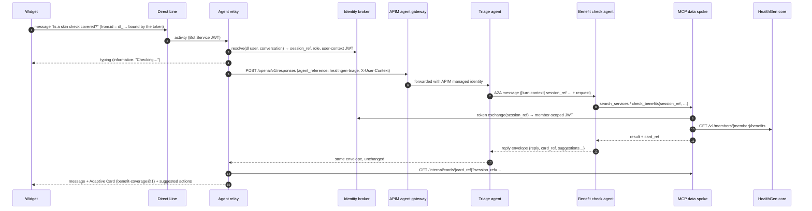

# Architecture

## One turn, end to end



## Contracts between the layers

**Widget ↔ relay (Direct Line).** These are the same activities the widget mock produces, documented in the widget README under "Relay contract":

- informative `typing` with a `streaminfo` entity;
- `message` with `channelData.resultChip` and `channelData.breadcrumb`;
- Adaptive Card attachments with `channelData.templateId`;
- `suggestedActions` (`channelData.recommended`);
- `navigate` and `handoff` events.

Card buttons arrive as `value.action = {type: "Action.Execute", verb, data}`. Portal journeys arrive as `startJourney`, page context as `context`, and the hand-off button as `handoffRequest`.

**Relay → agents.** Every turn goes to the **triage** agent through the Responses API, in one Foundry conversation per Direct Line conversation. The relay prefixes each input with:

```
[turn-context]
session_ref: ses_…
portal: member
locale: en-US
page: /benefits
[/turn-context]
```

The relay never sends member ids or names to the model. Card actions become one sentence built only from allow-listed refs, for example `service_ref=…, zip=…, radius_miles=…`. Free-text card inputs (office note, clinical note) never reach the model; they go to the broker with the confirmation.

**Agents → relay (reply envelope).** Each agent answers with one JSON object: `reply`, `card_ref`, `follow_up`, `result_chip`, `breadcrumb`, `suggestions`, `handoff`, `navigate`. See [agents/partials/envelope.md](../agents/partials/envelope.md) and `services/agent-relay/relay/envelope.py`. If the output is not valid JSON, the relay shows it as plain text. If `card_ref` is missing, the relay falls back to the newest `card_ref` in the response's MCP call outputs.

**Cards come from data, not from the model.** MCP tools build card data from core responses, store it under a short `card_ref` bound to the session, and return only the ref. The relay fetches the data, checks the template id against its allowlist (`services/agent-relay/templates`), binds the template and sends the card. So the facts on a card always come from the system of record.

## Human in the loop for writes

```mermaid
sequenceDiagram
  participant B as Benefit check agent
  participant M as MCP
  participant IB as Broker
  participant R as Relay
  participant U as Member
  participant C as Core
  B->>M: prepare_appointment_request(session_ref, provider, slot, service)
  M->>C: re-check slot and coverage
  M->>IB: POST /v1/actions → act_… (pending, params pinned, member from the session)
  M-->>B: card_ref (booking-review@1 with actionId)
  R-->>U: review card "Nothing is booked until you confirm"
  U->>R: Confirm (verb appointment.confirm, actionId, officeNote)
  R->>IB: GET action (pending? right kind?) then POST confirm (+ note)
  R->>B: "The user confirmed request act_… Call submit_appointment_request"
  B->>M: submit_appointment_request(session_ref, act_…)
  M->>IB: token exchange with action_id → one-time JWT (confirmed_action = id, kind, sha256(params)); action consumed
  M->>C: POST /v1/appointments/requests with the broker's pinned params
  C->>C: verify confirmed_action hash and single use (jti)
```

The model cannot book or refer on its own. Calling `submit_*` before the user confirms fails with `confirmation_required`. A second confirm fails because the action is already consumed. The parameters come from the broker, not from the model, so they can't be changed between review and submit. A newer review card supersedes older pending actions of the same kind.

## Agent topology

| Agent | Tools | Data |
| --- | --- | --- |
| `healthgen-triage` | A2A → benefit check, A2A → plan FAQ, MCP `request_human_handoff` only | PHI in transit only |
| `healthgen-benefit-check` | MCP (11 tools), AI Search (plan documents) | PHI |
| `healthgen-plan-faq` | AI Search only | No PHI |

A2A 1.0 carries text only. That is why the session ref travels inside the message text and cards travel as `card_ref`.
