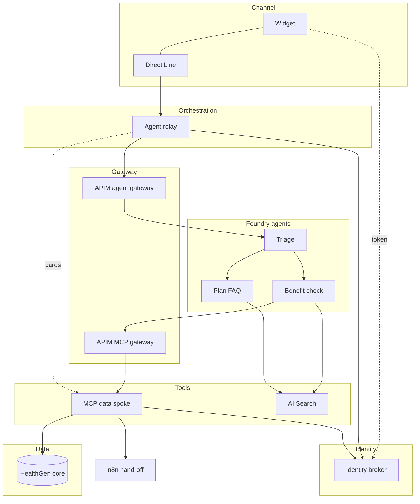

# HealthGen agentic solution: technical documentation

This is the technical reference for the solution behind the Agentic Client Widget. It covers how each layer works, how a request moves through all of them, and, for every file in the repo, what it does and what it becomes in the real system.

| If you want to… | Read |
| --- | --- |
| See how a request moves through every layer | [Sequence diagrams](sequences.md) (10 flows) |
| Understand the overall design | [Architecture](../architecture.md) |
| Review security | [Identity and security](../identity-and-security.md) |
| Deploy to Azure | [Deployment runbook](../deployment-runbook.md) |
| Run or scale the pilot | [Operations](../operations.md) |
| Look up one file | [File reference](#file-reference) below |

## Environments: what is real, a stand-in, or a mock

| Layer | Component | Local run | Pilot in Azure | Production |
| --- | --- | --- | --- | --- |
| Channel | Widget (`agent-widget` repo) | Real (vendored build) | Real | Real |
| Portal | Portal BFF token endpoint | Stand-in: [`portal-dev/server.py`](files/clients/portal-dev/server.py.md) | Your BFF | Your BFF |
| Channel | Direct Line | Stand-in: [`dev_server.py`](files/services/agent-relay/dev_server.py.md) | Azure Bot Service | Same |
| Orchestration | Agent relay | Real core in the emulator | Real: [`host_m365.py`](files/services/agent-relay/host_m365.py.md) | Same, with shared state |
| Identity | Identity broker | Real (local key, dev keys) | Real (Key Vault HSM, Entra) | Same, with Redis or Cosmos DB |
| Gateway | APIM | Stand-in: checks in [`foundry-local`](files/services/foundry-local/app.py.md) | Real: [`apim/`](files/apim/foundry-gateway.policy.xml.md) | Same |
| Agents | Triage, benefit check, plan FAQ | Stand-in: scripted router (not an LLM) | Real: [`agents/*.yaml`](files/agents/triage.yaml.md) | Same |
| Knowledge | Plan-document search | Stand-in: keyword search | Azure AI Search | Same, with real documents |
| Tools | MCP data spoke | Real | Real | Same, with a shared card store |
| Data | HealthGen core | **Mock** | **Mock** | Real core APIs (same contract) |
| Operations | Hand-off | Stand-in: stub route | n8n | n8n plus CRM |

The rule of thumb: everything under `services/` except `foundry-local` and `healthgen-core-mock` is production code. The stand-ins exist so you can run and test that production code without Azure.

## Layers at a glance

## Conventions used on the file pages

Every file page has the same parts:

- the **source path**;
- a one-line **summary**;
- **where it runs** (local, Azure, production);
- **what it does** and **how it works**;
- **configuration**, where the file has any;
- **how it's used in the real system**;
- **related** files, tests and flows.

⚠️ marks behaviour written from the documentation that has not yet been run against Azure.

## File reference

Every file in the repository has a page. The table is generated from `git ls-files` (see `docs/technical/build_index.py`).

<!-- FILE-INDEX:START -->

### Agent relay

| File | What it does |
| --- | --- |
| [`services/agent-relay/.env.agui.example`](files/services/agent-relay/.env.agui.example.md) | Example environment for running `host_agui.py` outside the local stack script. |
| [`services/agent-relay/.env.example`](files/services/agent-relay/.env.example.md) | A documented template of every environment variable the relay reads, with local defaults and the Azure value in a comment beside each. |
| [`services/agent-relay/Dockerfile`](files/services/agent-relay/Dockerfile.md) | The container image of the Agent relay for Azure Container Apps. It runs `python host_m365.py` on port 3978 as a non-root user. |
| [`services/agent-relay/Dockerfile.agui`](files/services/agent-relay/Dockerfile.agui.md) | Container image for the relay's AG-UI host: runs `uvicorn host_agui:app` on port 8106 as a non-root user, with a 75 s keep-alive for long SSE responses. |
| [`services/agent-relay/dev_server.py`](files/services/agent-relay/dev_server.py.md) | A local Direct Line 3.0 emulator with the real relay core running in the same process. It lets the real widget and broker run end to end without Azure Bot Service. |
| [`services/agent-relay/host_agui.py`](files/services/agent-relay/host_agui.py.md) | The relay's AG-UI host, an alternative to `host_m365.py` + Bot Service + Direct Line: `POST /agui/run` streams AG-UI events over SSE, and `GET /agui/threads/{id}` restores a thread. |
| [`services/agent-relay/host_m365.py`](files/services/agent-relay/host_m365.py.md) | The production entry point of the Agent relay. It hosts `RelayCore` on the Microsoft 365 Agents SDK (Python, aiohttp) at `POST /api/messages`, behind Azure Bot Service and Direct Line. |
| [`services/agent-relay/relay/__init__.py`](files/services/agent-relay/relay/__init__.py.md) | An empty file that makes `relay/` a Python package, so `host_m365.py`, `dev_server.py` and the tests can `import relay.core`. |
| [`services/agent-relay/relay/agui.py`](files/services/agent-relay/relay/agui.py.md) | The protocol layer of the relay's AG-UI host: it turns a `RunAgentInput` into the activities `RelayCore` already understands, and turns the core's reply activities into AG-UI events. |
| [`services/agent-relay/relay/clients.py`](files/services/agent-relay/relay/clients.py.md) | The relay's outbound HTTP clients for the identity broker, the MCP card store and Foundry (through APIM), plus credential helpers. |
| [`services/agent-relay/relay/core.py`](files/services/agent-relay/relay/core.py.md) | The relay's brain. It turns one Direct Line activity into one agent turn and turns the agent's reply into Direct Line activities, enforcing every rule that must not depend on the model. |
| [`services/agent-relay/relay/envelope.py`](files/services/agent-relay/relay/envelope.py.md) | Parses and validates the JSON reply envelope that agents return, and masks sensitive patterns in all outbound text and logs. |
| [`services/agent-relay/relay/factory.py`](files/services/agent-relay/relay/factory.py.md) | Builds a `RelayCore` from environment variables. `host_m365.py` and `dev_server.py` share it, so both hosts configure the relay the same way. |
| [`services/agent-relay/relay/msi.py`](files/services/agent-relay/relay/msi.py.md) | Gets Entra access tokens for the container's managed identity, with stdlib HTTP only. |
| [`services/agent-relay/relay/templating.py`](files/services/agent-relay/relay/templating.py.md) | A small, safe implementation of Adaptive Cards Templating in Python. It binds the JSON templates in `templates/` to the card data from the MCP card store. |
| [`services/agent-relay/requirements-agui.txt`](files/services/agent-relay/requirements-agui.txt.md) | Python dependencies of the AG-UI host: the relay core's `requirements.txt` plus PyJWT with crypto, for checking the broker's chat token. |
| [`services/agent-relay/requirements-host.txt`](files/services/agent-relay/requirements-host.txt.md) | The extra dependencies for the production host: the Microsoft 365 Agents SDK (`microsoft-agents-hosting-aiohttp`, `microsoft-agents-authentication-msal`, `microsoft-agents-activity`) and `aiohttp`. It includes `requirements.txt`. |
| [`services/agent-relay/requirements.txt`](files/services/agent-relay/requirements.txt.md) | The pinned dependencies of the relay core and the local Direct Line emulator: `starlette`, `uvicorn[standard]`, `pydantic` and `anyio`. |
| [`services/agent-relay/templates/availability-slots@1.json`](files/services/agent-relay/templates/availability-slots@1.json.md) | Adaptive Card template `availability-slots@1`. Open appointment times with the chosen doctor. Choosing a time does not book it. |
| [`services/agent-relay/templates/benefit-coverage@1.json`](files/services/agent-relay/templates/benefit-coverage@1.json.md) | Adaptive Card template `benefit-coverage@1`. Benefit check result (prototype screen 2): the service, the plan and year, a coverage badge, a fact list (network, visit cost, deductible, referral, prior auth, limits) and a notice. |
| [`services/agent-relay/templates/booking-review@1.json`](files/services/agent-relay/templates/booking-review@1.json.md) | Adaptive Card template `booking-review@1`. Human-in-the-loop review of an appointment request. The facts come from the broker's pending action, and nothing is booked until Confirm. |
| [`services/agent-relay/templates/confirmation@1.json`](files/services/agent-relay/templates/confirmation@1.json.md) | Adaptive Card template `confirmation@1`. The result of a completed write (*Booked* or *Submitted*): a status badge, a title, reference facts and a notice. |
| [`services/agent-relay/templates/provider-results@1.json`](files/services/agent-relay/templates/provider-results@1.json.md) | Adaptive Card template `provider-results@1`. In-network doctors (prototype screens 1 and 4). The actions differ by audience: members get *Check availability*, providers get *Review referral*. |
| [`services/agent-relay/templates/referral-review@1.json`](files/services/agent-relay/templates/referral-review@1.json.md) | Adaptive Card template `referral-review@1`. Provider review of a drafted referral, with a required medical-necessity attestation. |
| [`services/agent-relay/templates/service-options@1.json`](files/services/agent-relay/templates/service-options@1.json.md) | Adaptive Card template `service-options@1`. Service search (prototype screen 3): ZIP and distance inputs plus a selectable list of covered services matching the need. |
| [`services/agent-relay/tests/test_agui.py`](files/services/agent-relay/tests/test_agui.py.md) | HTTP + SSE tests of `host_agui` with the real `RelayCore` and the in-process fakes from `test_relay.py`. |
| [`services/agent-relay/tests/test_relay.py`](files/services/agent-relay/tests/test_relay.py.md) | Unit tests for the relay core, envelope parsing, masking and templates. The broker, card store and Foundry are replaced by in-process fakes, so the tests are fast and deterministic. |

### Identity broker

| File | What it does |
| --- | --- |
| [`services/identity-broker/.env.example`](files/services/identity-broker/.env.example.md) | A template of every broker setting, with local defaults and Azure alternatives in comments. |
| [`services/identity-broker/Dockerfile`](files/services/identity-broker/Dockerfile.md) | The container image of the identity broker: `python:3.13-slim`, the pinned requirements and `app/`, run as UID 10001 with `uvicorn app.main:app --port 8102 --proxy-headers`. |
| [`services/identity-broker/app/__init__.py`](files/services/identity-broker/app/__init__.py.md) | An empty file that makes `app/` a Python package (`uvicorn app.main:app`, relative imports between modules). |
| [`services/identity-broker/app/agui.py`](files/services/identity-broker/app/agui.py.md) | The broker's AG-UI token endpoint, `POST /v1/agui/token`. It exchanges a portal assertion for a short chat token bound to one AG-UI thread, the counterpart of `/v1/directline/token`. |
| [`services/identity-broker/app/auth.py`](files/services/identity-broker/app/auth.py.md) | Decides who is calling the broker: portal BFFs (signed portal assertions) or internal services (Entra managed identity tokens, or dev keys). |
| [`services/identity-broker/app/directline.py`](files/services/identity-broker/app/directline.py.md) | The server-side Direct Line 3.0 calls that need the channel secret: generating a user-bound token, and reconnecting to an existing conversation. |
| [`services/identity-broker/app/main.py`](files/services/identity-broker/app/main.py.md) | The identity broker's HTTP API. It binds Direct Line users to portal users, issues user-context tokens, keeps pending write actions for human confirmation, and performs RFC 8693 token exchange for the MCP server. |
| [`services/identity-broker/app/main_agui.py`](files/services/identity-broker/app/main_agui.py.md) | Broker entry point for the AG-UI path: the unchanged `main.create_app` plus the `/v1/agui/token` route, and able to start without a Direct Line secret. |
| [`services/identity-broker/app/signer.py`](files/services/identity-broker/app/signer.py.md) | Signs the broker's JWTs. Locally it uses an RSA key; in Azure it uses an HSM-backed Azure Key Vault key, so the private key never leaves Key Vault. |
| [`services/identity-broker/app/store.py`](files/services/identity-broker/app/store.py.md) | The broker's state: session bindings and pending actions, in SQLite for the pilot. It holds refs only and no PHI. |
| [`services/identity-broker/requirements.txt`](files/services/identity-broker/requirements.txt.md) | The broker's pinned dependencies: `starlette`, `uvicorn[standard]`, `PyJWT[crypto]`, `cryptography` and `python-multipart` (for the form-encoded `/oauth2/token`). |
| [`services/identity-broker/tests/test_agui_tokens.py`](files/services/identity-broker/tests/test_agui_tokens.py.md) | Unit tests for the AG-UI chat token endpoint against a real broker app with a fake portal key. |
| [`services/identity-broker/tests/test_broker.py`](files/services/identity-broker/tests/test_broker.py.md) | Tests the broker over real HTTP, with a fake Direct Line, a test portal key and a fake Key Vault. Run with `cd services/identity-broker && python -m unittest discover -s tests` (11 tests). |

### MCP data spoke

| File | What it does |
| --- | --- |
| [`services/mcp-healthgen/.env.example`](files/services/mcp-healthgen/.env.example.md) | A template of the MCP server's settings: upstream URLs, broker credential, inbound auth for `/mcp` and `/internal`, allowed hosts and the hand-off webhook. |
| [`services/mcp-healthgen/Dockerfile`](files/services/mcp-healthgen/Dockerfile.md) | The container image of the MCP data spoke: `python:3.13-slim`, run as UID 10001 with `uvicorn app.main:app --port 8103`. |
| [`services/mcp-healthgen/app/__init__.py`](files/services/mcp-healthgen/app/__init__.py.md) | An empty package marker for `app/` (`uvicorn app.main:app`). Keep it free of side effects. |
| [`services/mcp-healthgen/app/cards.py`](files/services/mcp-healthgen/app/cards.py.md) | Builds Adaptive Card data from core responses and stores it under short, session-bound `card_ref`s, so the relay renders cards from system-of-record data instead of model text. |
| [`services/mcp-healthgen/app/clients.py`](files/services/mcp-healthgen/app/clients.py.md) | The MCP server's HTTP clients: the identity broker (token exchange, pending actions), HealthGen core, and the signed n8n hand-off webhook. |
| [`services/mcp-healthgen/app/main.py`](files/services/mcp-healthgen/app/main.py.md) | Builds the MCP server: Streamable HTTP at `/mcp` (stateless, JSON responses), a guard that authenticates callers, and the internal card endpoint the relay uses. |
| [`services/mcp-healthgen/app/msi.py`](files/services/mcp-healthgen/app/msi.py.md) | Gets managed identity tokens (Container Apps identity endpoint, falling back to IMDS) so the MCP server can authenticate to the broker in Azure. It is a copy of the relay's `msi.py`. |
| [`services/mcp-healthgen/app/tools.py`](files/services/mcp-healthgen/app/tools.py.md) | The 12 MCP tools that Foundry agents call to read and change HealthGen data. Each tool is scoped by `session_ref`, writes need user confirmation, and card data is built from system-of-record responses. |
| [`services/mcp-healthgen/requirements.txt`](files/services/mcp-healthgen/requirements.txt.md) | Pinned dependencies: `mcp==2.2.0` (MCP Python SDK v2, which also brings `httpx2`), `starlette`, `uvicorn[standard]`, `PyJWT[crypto]`, `cryptography`, `pydantic` and `anyio`. |
| [`services/mcp-healthgen/tests/test_mcp.py`](files/services/mcp-healthgen/tests/test_mcp.py.md) | An integration test that uses the **real MCP client** against the real MCP server, the real identity broker and the core mock on localhost, with a fake Direct Line and a fake n8n that checks the HMAC signature. Run with `cd services/mcp-healthgen && python -m unittest discover -s tests` (9 tests). |

### HealthGen core mock

| File | What it does |
| --- | --- |
| [`services/healthgen-core-mock/.env.example`](files/services/healthgen-core-mock/.env.example.md) | The core mock's settings: `BROKER_ISSUER` (expected token issuer), `CORE_JWKS_URL` (broker public keys), optional `CORE_TODAY` (pin the date for demos) and `LOG_LEVEL`. |
| [`services/healthgen-core-mock/Dockerfile`](files/services/healthgen-core-mock/Dockerfile.md) | The container image of the core mock: `python:3.13-slim`, run as UID 10001 with `uvicorn app.main:app --port 8101`. |
| [`services/healthgen-core-mock/README.md`](files/services/healthgen-core-mock/README.md.md) | The core HTTP contract in one page: each route, its required scope, and the rules (member match, provider panel, one-time confirmed action). |
| [`services/healthgen-core-mock/app/__init__.py`](files/services/healthgen-core-mock/app/__init__.py.md) | An empty package marker for `app/`. Keep it free of side effects. |
| [`services/healthgen-core-mock/app/auth.py`](files/services/healthgen-core-mock/app/auth.py.md) | Validates the broker's downstream JWT, exposes the caller as a `Principal`, and consumes one-time write confirmations. |
| [`services/healthgen-core-mock/app/data.py`](files/services/healthgen-core-mock/app/data.py.md) | Invented data that matches the Care assistant prototype: two members, two plans, dermatology benefits, five providers, ZIP centroids and deterministic appointment slots. |
| [`services/healthgen-core-mock/app/main.py`](files/services/healthgen-core-mock/app/main.py.md) | The HealthGen core mock's HTTP API: member, eligibility, accumulators, benefits, prior auth, service catalogue, providers, availability, and the two write endpoints (appointments, referrals). It enforces the same authorization rules the real core must enforce. |
| [`services/healthgen-core-mock/requirements.txt`](files/services/healthgen-core-mock/requirements.txt.md) | Pinned dependencies: `starlette`, `uvicorn[standard]`, `PyJWT[crypto]` and `cryptography`. |
| [`services/healthgen-core-mock/tests/test_core.py`](files/services/healthgen-core-mock/tests/test_core.py.md) | HTTP tests for the core mock, with a test RSA key acting as the broker and the date pinned to 14 Oct 2026. Run with `cd services/healthgen-core-mock && python -m unittest discover -s tests` (12 tests). |

### Foundry and APIM local stand-in

| File | What it does |
| --- | --- |
| [`services/foundry-local/app.py`](files/services/foundry-local/app.py.md) | A local stand-in for **APIM plus Foundry Agent Service** (and the n8n webhook). It speaks the same HTTP contract as the real ones, so the relay, MCP server, broker and widget run unchanged on a laptop. It is a scripted router, **not an LLM**. |
| [`services/foundry-local/requirements.txt`](files/services/foundry-local/requirements.txt.md) | Dependencies of the local Foundry stand-in: `mcp==2.2.0` (MCP client), `starlette`, `uvicorn[standard]`, `PyJWT[crypto]` and `PyYAML` (to read the plan documents' front matter through `search/ingest.py`). |

### Foundry agents

| File | What it does |
| --- | --- |
| [`agents/README.md`](files/agents/README.md.md) | A guide to the agent folder: the three agents and their tools, the YAML format and placeholders, how to deploy, and the rules every agent follows. |
| [`agents/benefit-check.yaml`](files/agents/benefit-check.yaml.md) | A declarative definition of `healthgen-benefit-check`, the specialist for member-specific coverage, finding care, availability, booking and referrals. It uses the HealthGen MCP tools and the plan-document index. |
| [`agents/connections.yaml`](files/agents/connections.yaml.md) | The Foundry project connections that the agents reference as `${conn:NAME}`: AI Search, the HealthGen MCP server, and two RemoteA2A connections to the specialists. |
| [`agents/deploy_agents.py`](files/agents/deploy_agents.py.md) | Deploys the declarative agents and connections to a Foundry project: it fills in placeholders, PUTs the connections, creates the agents or new agent versions, and enables incoming A2A on the specialists. It needs PyYAML and the Azure CLI only. |
| [`agents/foundry.env.example`](files/agents/foundry.env.example.md) | A template of the settings `deploy_agents.py` needs: subscription, resource group, Foundry account and project, model deployment, MCP URL and audience, and the search service and index. |
| [`agents/partials/envelope.md`](files/agents/partials/envelope.md.md) | The shared "how to answer" contract, inserted into every agent's instructions with `{{> envelope}}`. Agents answer with one JSON reply envelope that the relay renders. |
| [`agents/plan-faq.yaml`](files/agents/plan-faq.yaml.md) | A declarative definition of `healthgen-plan-faq`. It answers general plan questions only from the plan documents in Azure AI Search, with no member data or PHI. |
| [`agents/triage.yaml`](files/agents/triage.yaml.md) | A declarative definition of `healthgen-triage`, the Foundry prompt agent that the relay calls on every turn. It routes to the specialists over A2A, handles greetings and out-of-scope requests, and starts human hand-offs. |

### Plan documents and search

| File | What it does |
| --- | --- |
| [`search/documents/harbor-hmo-2026-eoc-referrals.md`](files/search/documents/harbor-hmo-2026-eoc-referrals.md.md) | A synthetic plan document, "Harbor HMO 2026 Evidence of Coverage: referrals and prior authorization", indexed for the plan FAQ and benefit check agents. It is not a real plan. |
| [`search/documents/harbor-hmo-2026-sbc.md`](files/search/documents/harbor-hmo-2026-sbc.md.md) | A synthetic plan document, "Harbor HMO 2026 Summary of Benefits and Coverage", indexed for the plan FAQ and benefit check agents. It is not a real plan. |
| [`search/documents/harbor-ppo-2026-sbc.md`](files/search/documents/harbor-ppo-2026-sbc.md.md) | A synthetic plan document, "Harbor PPO 2026 Summary of Benefits and Coverage", indexed for the plan FAQ and benefit check agents. It is not a real plan. |
| [`search/documents/healthgen-member-faq.md`](files/search/documents/healthgen-member-faq.md.md) | A synthetic plan document, "HealthGen member FAQ", indexed for the plan FAQ and benefit check agents. It is not a real plan. |
| [`search/index.json`](files/search/index.json.md) | The Azure AI Search index schema `healthgen-plan-docs`: the fields, and the semantic configuration that the agents' `query_type: semantic` relies on. |
| [`search/ingest.py`](files/search/ingest.py.md) | Creates or updates the Azure AI Search index for plan documents and uploads the documents, one chunk per `#` section. |

### API Management

| File | What it does |
| --- | --- |
| [`apim/foundry-gateway.policy.xml`](files/apim/foundry-gateway.policy.xml.md) | The APIM policy for the **agent gateway** (relay → Foundry). It authenticates the relay and the end-user session, applies guardrails, and calls Foundry with APIM's own managed identity. |
| [`apim/mcp-gateway.policy.xml`](files/apim/mcp-gateway.policy.xml.md) | The APIM policy for the **MCP gateway** (Foundry → HealthGen MCP). It accepts only the Foundry project's managed identity, only `POST /mcp`, applies limits, and calls the MCP server with APIM's identity. |

### Hand-off

| File | What it does |
| --- | --- |
| [`handoff/healthgen-handoff.n8n.json`](files/handoff/healthgen-handoff.n8n.json.md) | An importable n8n workflow for human hand-off. It verifies the MCP server's signed webhook, creates a ticket, notifies the care team and returns the ticket ref to the agent. |

### Portal stand-in

| File | What it does |
| --- | --- |
| [`clients/agent-widget/.gitignore`](files/clients/agent-widget/.gitignore.md) | Ignores `node_modules`, `dist/`, `artifact/` and browser test screenshots. |
| [`clients/agent-widget/README.md`](files/clients/agent-widget/README.md.md) | The widget's own README: host API, events, theming, cards and security notes. |
| [`clients/agent-widget/demo/blank.html`](files/clients/agent-widget/demo/blank.html.md) | Blank host page used by the browser tests. |
| [`clients/agent-widget/demo/index.html`](files/clients/agent-widget/demo/index.html.md) | The widget playground page, running against the mock relay. |
| [`clients/agent-widget/package.json`](files/clients/agent-widget/package.json.md) | Package manifest: name, version, exports, scripts (`build`, `test`, `test:e2e`, `test:sdk`) and dependencies (`marked`, `dompurify`). |
| [`clients/agent-widget/scripts/build-demo-artifact.mjs`](files/clients/agent-widget/scripts/build-demo-artifact.mjs.md) | Inlines the demo page and bundles into one self-contained HTML file. |
| [`clients/agent-widget/scripts/build.mjs`](files/clients/agent-widget/scripts/build.mjs.md) | Builds the widget bundles with esbuild into `dist/` (ESM, IIFE with global `AgentWidget`, mock and SDK adapter). |
| [`clients/agent-widget/scripts/serve.mjs`](files/clients/agent-widget/scripts/serve.mjs.md) | A minimal static server for the demo and the browser tests. |
| [`clients/agent-widget/src/cards/lite/lite-renderer.ts`](files/clients/agent-widget/src/cards/lite/lite-renderer.ts.md) | The built-in, dependency-free Adaptive Cards renderer for the schema subset the card catalogue uses. |
| [`clients/agent-widget/src/cards/renderer.ts`](files/clients/agent-widget/src/cards/renderer.ts.md) | The card renderer contract, so the widget can use the built-in lite renderer or Microsoft's SDK. |
| [`clients/agent-widget/src/cards/sdk-adapter.ts`](files/clients/agent-widget/src/cards/sdk-adapter.ts.md) | Adapter for Microsoft's `adaptivecards` SDK (`createSdkRenderer`). Not run in the build environment. |
| [`clients/agent-widget/src/core/agui.ts`](files/clients/agent-widget/src/core/agui.ts.md) | `AgUiTransport`: the widget's AG-UI transport. It implements the same `Transport` interface as `DirectLineTransport`, so the UI, card renderer and host events don't change. |
| [`clients/agent-widget/src/core/conversation.ts`](files/clients/agent-widget/src/core/conversation.ts.md) | `ConversationStore`: turns the activity stream into chat items (user messages, bot messages, typing, cards, chips) and handles streaming typing. |
| [`clients/agent-widget/src/core/directline.ts`](files/clients/agent-widget/src/core/directline.ts.md) | `DirectLineTransport` (Direct Line 3.0 over WebSocket or polling, token refresh, resume) and `tokenUrlFetcher`, which calls the portal BFF's token endpoint. |
| [`clients/agent-widget/src/core/i18n.ts`](files/clients/agent-widget/src/core/i18n.ts.md) | UI strings and the locale lookup. |
| [`clients/agent-widget/src/core/markdown.ts`](files/clients/agent-widget/src/core/markdown.ts.md) | Renders bot markdown with `marked` and sanitizes it with DOMPurify (small tag allowlist, safe links only). |
| [`clients/agent-widget/src/core/policy.ts`](files/clients/agent-widget/src/core/policy.ts.md) | Client-side checks for navigate routes and URLs against the host's allowlists, plus small helpers. Defence in depth only. |
| [`clients/agent-widget/src/core/telemetry.ts`](files/clients/agent-widget/src/core/telemetry.ts.md) | Privacy-safe telemetry events and W3C `traceparent` ids. |
| [`clients/agent-widget/src/core/transport.ts`](files/clients/agent-widget/src/core/transport.ts.md) | The `Transport` interface (connect, post, activity and status listeners) and the small `Emitter` used by every transport. |
| [`clients/agent-widget/src/index.ts`](files/clients/agent-widget/src/index.ts.md) | Public entry of the widget package. Importing it registers `<agent-widget>` and exports the transports, store, renderers and types. |
| [`clients/agent-widget/src/mock/data.ts`](files/clients/agent-widget/src/mock/data.ts.md) | Illustrative members, services, providers and slots for the mock relay. |
| [`clients/agent-widget/src/mock/index.ts`](files/clients/agent-widget/src/mock/index.ts.md) | Entry of the mock relay bundle (`AgentWidgetMock`). Demo and test use only. |
| [`clients/agent-widget/src/mock/mock-relay.ts`](files/clients/agent-widget/src/mock/mock-relay.ts.md) | `MockRelayTransport`, an in-browser stand-in for Direct Line + the relay, used by the demo and UI tests. |
| [`clients/agent-widget/src/mock/templating.ts`](files/clients/agent-widget/src/mock/templating.ts.md) | A minimal Adaptive Cards templating engine used only by the mock relay. |
| [`clients/agent-widget/src/types.ts`](files/clients/agent-widget/src/types.ts.md) | Public types: host API (`WidgetOptions`, context, events), the Direct Line activity subset the widget renders, and token request/response shapes. |
| [`clients/agent-widget/src/ui/agent-widget.ts`](files/clients/agent-widget/src/ui/agent-widget.ts.md) | The `<agent-widget>` custom element: shadow DOM UI, connection lifecycle, card actions, journeys and host events. |
| [`clients/agent-widget/src/ui/icons.ts`](files/clients/agent-widget/src/ui/icons.ts.md) | Static inline SVG icons. |
| [`clients/agent-widget/src/ui/styles.ts`](files/clients/agent-widget/src/ui/styles.ts.md) | Shadow DOM styles for the widget chrome and the `ac-*` card classes. |
| [`clients/agent-widget/src/ui/theme.ts`](files/clients/agent-widget/src/ui/theme.ts.md) | Default theme tokens and how portal overrides are applied. |
| [`clients/agent-widget/src/version.ts`](files/clients/agent-widget/src/version.ts.md) | The widget version string, replaced at build time from `package.json`. |
| [`clients/agent-widget/templates/availability-slots@1.json`](files/clients/agent-widget/templates/availability-slots@1.json.md) | The `availability-slots@1` Adaptive Card template, used by the widget's mock relay and tests. |
| [`clients/agent-widget/templates/benefit-coverage@1.json`](files/clients/agent-widget/templates/benefit-coverage@1.json.md) | The `benefit-coverage@1` Adaptive Card template, used by the widget's mock relay and tests. |
| [`clients/agent-widget/templates/booking-review@1.json`](files/clients/agent-widget/templates/booking-review@1.json.md) | The `booking-review@1` Adaptive Card template, used by the widget's mock relay and tests. |
| [`clients/agent-widget/templates/confirmation@1.json`](files/clients/agent-widget/templates/confirmation@1.json.md) | The `confirmation@1` Adaptive Card template, used by the widget's mock relay and tests. |
| [`clients/agent-widget/templates/provider-results@1.json`](files/clients/agent-widget/templates/provider-results@1.json.md) | The `provider-results@1` Adaptive Card template, used by the widget's mock relay and tests. |
| [`clients/agent-widget/templates/referral-review@1.json`](files/clients/agent-widget/templates/referral-review@1.json.md) | The `referral-review@1` Adaptive Card template, used by the widget's mock relay and tests. |
| [`clients/agent-widget/templates/service-options@1.json`](files/clients/agent-widget/templates/service-options@1.json.md) | The `service-options@1` Adaptive Card template, used by the widget's mock relay and tests. |
| [`clients/agent-widget/test/e2e/run.mjs`](files/clients/agent-widget/test/e2e/run.mjs.md) | Headless Chromium walk-through of every journey against the mock relay, with screenshots. |
| [`clients/agent-widget/test/e2e/sdk-smoke.mjs`](files/clients/agent-widget/test/e2e/sdk-smoke.mjs.md) | Smoke test of the SDK renderer adapter with Microsoft's `adaptivecards` package. |
| [`clients/agent-widget/test/unit/agui.test.ts`](files/clients/agent-widget/test/unit/agui.test.ts.md) | Unit tests for `AgUiTransport` with a fake `fetch` that returns SSE streams split mid-frame. |
| [`clients/agent-widget/test/unit/core.test.ts`](files/clients/agent-widget/test/unit/core.test.ts.md) | Unit tests for templating, the conversation store and the policy helpers. |
| [`clients/agent-widget/test/unit/directline.test.ts`](files/clients/agent-widget/test/unit/directline.test.ts.md) | Unit tests for `DirectLineTransport` with a fake socket and fetch. |
| [`clients/agent-widget/tsconfig.json`](files/clients/agent-widget/tsconfig.json.md) | TypeScript settings for typechecking (`tsc --noEmit`). |
| [`clients/portal-dev-agui/index.html`](files/clients/portal-dev-agui/index.html.md) | Host page for the AG-UI local run. It is the `portal-dev` page with one change: `widget.init` injects `AgentWidget.AgUiTransport` instead of using Direct Line. |
| [`clients/portal-dev-agui/server.py`](files/clients/portal-dev-agui/server.py.md) | Portal stand-in for the AG-UI path: serves the host page and plays the portal BFF, exchanging a signed portal assertion at `POST /v1/agui/token` for the widget. |
| [`clients/portal-dev-agui/vendor/agent-widget.iife.js`](files/clients/portal-dev-agui/vendor/agent-widget.iife.js.md) | A vendored, minified build of `clients/agent-widget` (`dist/agent-widget.iife.js`) that includes `AgUiTransport`. It is here so the AG-UI local stack works without building the widget. |
| [`clients/portal-dev/index.html`](files/clients/portal-dev/index.html.md) | The local host page. It shows how a portal embeds `<agent-widget>` against the real stack, with a user switcher, three journey buttons and an event log. |
| [`clients/portal-dev/server.py`](files/clients/portal-dev/server.py.md) | A local stand-in for the member and provider portals. It serves the host page with the widget and plays the **portal backend (BFF)**: it signs portal assertions for fake signed-in users and exchanges them at the broker for Direct Line tokens. |
| [`clients/portal-dev/vendor/agent-widget.iife.js`](files/clients/portal-dev/vendor/agent-widget.iife.js.md) | A vendored, minified build of the Agentic Client Widget (from the separate `agent-widget` repo, `dist/agent-widget.iife.js`, v0.1.0). It is included so the local stack works without building the widget. |

### Scripts

| File | What it does |
| --- | --- |
| [`scripts/local_stack.py`](files/scripts/local_stack.py.md) | Starts the whole stack on localhost, as six uvicorn processes wired together with dev keys. The end-to-end tests also use it. |
| [`scripts/local_stack_agui.py`](files/scripts/local_stack_agui.py.md) | Starts the whole stack locally over AG-UI: core mock, broker (`app.main_agui`), MCP, Foundry stand-in, the relay's `host_agui` on 8106 and `portal-dev-agui` on 8081. No Direct Line emulator. |

### End-to-end tests

| File | What it does |
| --- | --- |
| [`tests/e2e/test_local_stack.py`](files/tests/e2e/test_local_stack.py.md) | An end-to-end test over HTTP, talking exactly as the widget does. It starts the six local processes on ports 9101–9105 and 9080 and drives the real flows through portal-dev, the broker, the Direct Line emulator, the relay, `foundry-local`, MCP and the core mock. |
| [`tests/e2e/test_local_stack_agui.py`](files/tests/e2e/test_local_stack_agui.py.md) | End-to-end tests over AG-UI: starts the local AG-UI stack and talks to it the way `AgUiTransport` does (BFF token, `RunAgentInput`, SSE). |

### Test helpers

| File | What it does |
| --- | --- |
| [`libs/testkit/testkit.py`](files/libs/testkit/testkit.py.md) | Shared, dependency-free test helpers: throwaway RSA keys with a JWKS view, an in-thread uvicorn server, and an HTTP helper that never uses environment proxies. |

### Design documents

| File | What it does |
| --- | --- |
| [`docs/ag-ui.md`](files/docs/ag-ui.md.md) | Guide to the AG-UI path: what was added on each layer, how the protocol maps onto cards, interrupts and events, what security controls carry over, how to run and test it locally, the deployment delta to the runbook, and the known limits. |
| [`docs/architecture.md`](files/docs/architecture.md.md) | The architecture overview: one turn end to end, the contracts between the layers (activities, turn context, reply envelope, cards from data), the human-in-the-loop write flow, and the agent topology. |
| [`docs/deployment-runbook.md`](files/docs/deployment-runbook.md.md) | A step-by-step Azure CLI deployment of the pilot, used instead of Terraform. |
| [`docs/identity-and-security.md`](files/docs/identity-and-security.md.md) | The identity and security design: why the in-house IdM identity is carried by the broker and not by the model, the six credentials and their lifetimes, the six rules that don't depend on the model, a threat-and-mitigation table, and production follow-ups. |
| [`docs/operations.md`](files/docs/operations.md.md) | Running the pilot: which component holds which state (and the limits that puts on replicas), what is and isn't logged, suggested alerts, and how to roll out agent and card changes safely. |

### Repository root

| File | What it does |
| --- | --- |
| [`.gitignore`](files/.gitignore.md) | Keeps local and secret files out of git: Python caches, `.env` files, SQLite databases (`*.db` and WAL files), `dev-keys/`, virtual environments, `node_modules/` and `dist/`. |
| [`README.md`](files/README.md.md) | The front page of the repo: an architecture diagram, a table of each component and what it does, how to run the stack locally, how to run the tests, and the list of pieces not yet verified against Azure. |
<!-- FILE-INDEX:END -->
