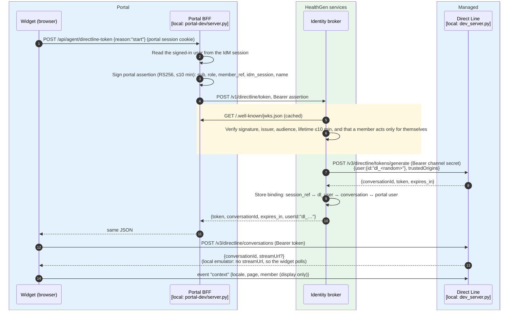
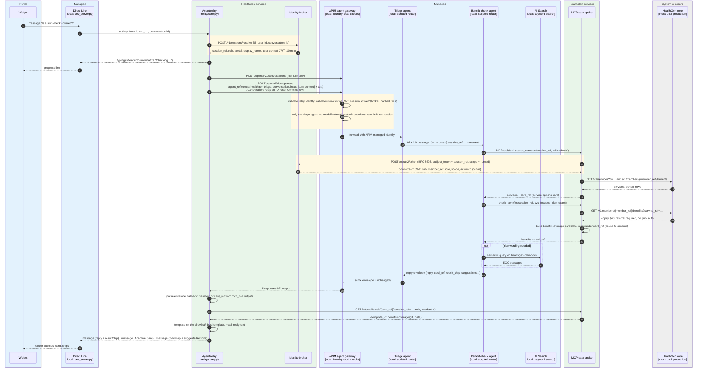
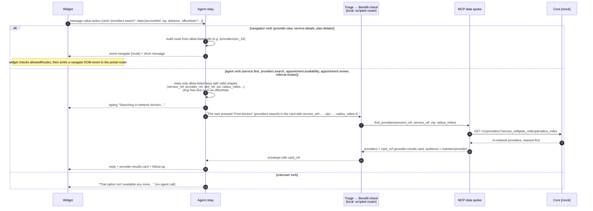
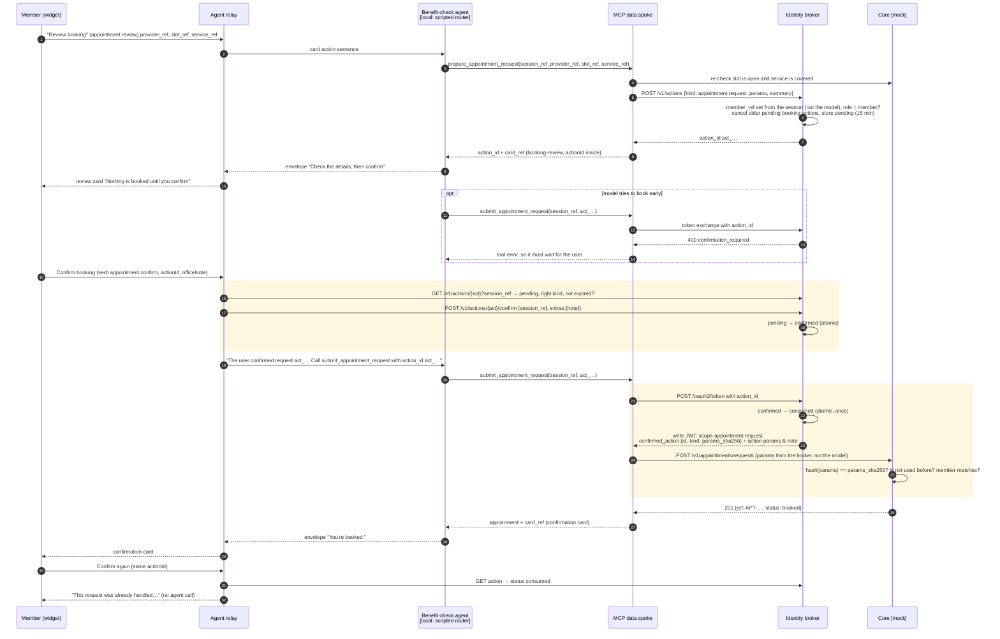
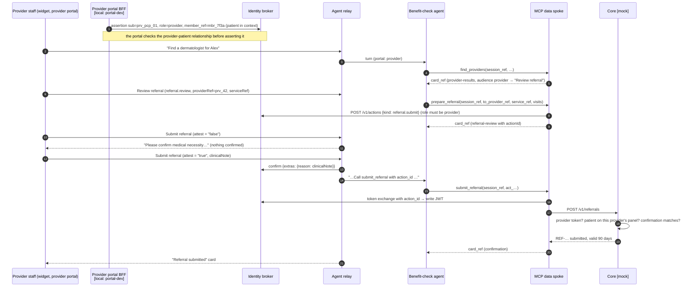
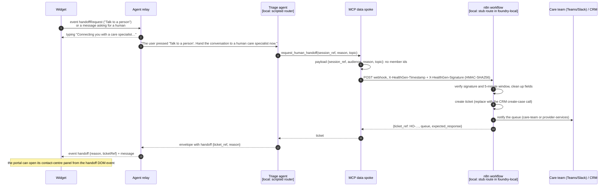
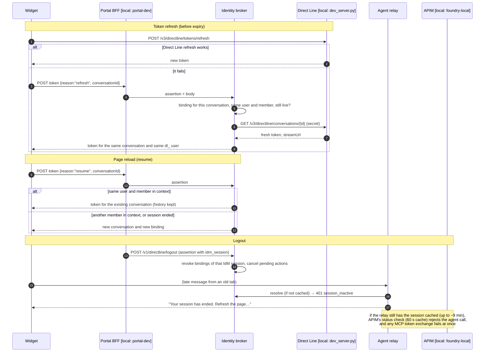
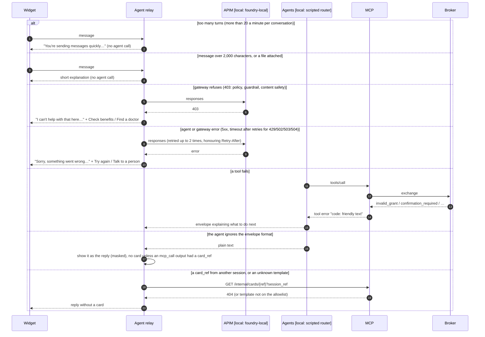
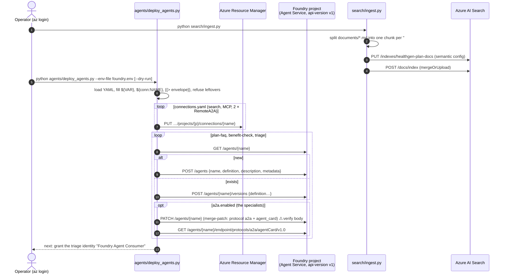
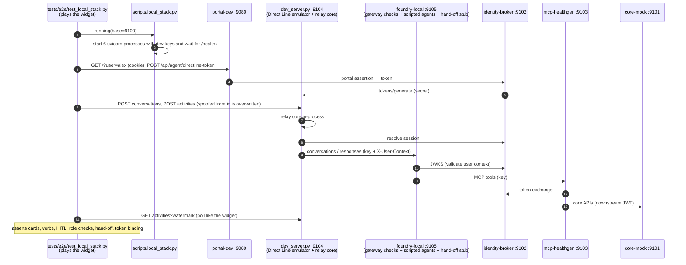

# Sequence diagrams

These diagrams show how a request moves through every layer of the HealthGen care assistant. Each participant is labelled with what runs in each environment:

| Layer | Local run (`scripts/local_stack.py`) | Pilot in Azure | Production |
| --- | --- | --- | --- |
| Widget | Real (`agent-widget` build, vendored) | Real | Real |
| Portal backend (BFF) | **Local stand-in:** `clients/portal-dev/server.py` | Your portal BFF | Your portal BFF |
| Direct Line | **Local stand-in:** `services/agent-relay/dev_server.py` | Azure Bot Service, Direct Line | Same |
| Agent relay | Real code (`relay/core.py`) inside `dev_server.py` | Real code in `host_m365.py` (M365 Agents SDK) | Same |
| Identity broker | Real code, local RSA key, shared keys | Real code, Key Vault HSM key, Entra service auth | Same, with shared state (Redis or Cosmos DB) |
| APIM gateways | **Local stand-in:** checks in `services/foundry-local/app.py` | Azure API Management (`apim/*.xml`) | Same |
| Foundry agents | **Local stand-in:** scripted router in `foundry-local` (not an LLM) | Foundry prompt agents (`agents/*.yaml`) | Same |
| AI Search | **Local stand-in:** keyword search over `search/documents` | Azure AI Search | Same, with your real plan documents |
| MCP data spoke | Real code | Real code | Same, with a shared card store |
| HealthGen core | **Mock:** `services/healthgen-core-mock` | **Mock** | Real HealthGen core APIs |
| Hand-off | **Local stand-in:** stub route in `foundry-local` | n8n workflow (`handoff/`) | n8n plus your CRM |

Each diagram is also exported as an SVG in [`images/`](images/) for Confluence, wikis or slides. Regenerate them with `mmdc` (mermaid-cli) after you edit a diagram.

How to read the diagrams:

- The coloured boxes group the participants.
  - **Green:** code from this repo that runs unchanged everywhere.
  - **Blue:** a managed service or portal piece that has a local stand-in.
  - **Grey:** the system of record, which is mocked until production.
- Participant names say **[local: …]** when a stand-in replaces the real thing on a laptop.
- `rect` shading marks the security checks that do not depend on the model.

Contents:

1. [Start a chat session](#1-start-a-chat-session)
2. [A benefit-check question](#2-a-benefit-check-question)
3. [Pressing a card button](#3-pressing-a-card-button)
4. [Booking with human confirmation](#4-booking-with-human-confirmation)
5. [Provider referral](#5-provider-referral)
6. [Hand-off to a care specialist](#6-hand-off-to-a-care-specialist)
7. [Resume, token refresh and logout](#7-resume-token-refresh-and-logout)
8. [Failures and guardrails](#8-failures-and-guardrails)
9. [Deploying agents and plan documents](#9-deploying-agents-and-plan-documents)
10. [Local stack and automated tests](#10-local-stack-and-automated-tests)

---

## 1. Start a chat session

The widget never sees a Direct Line secret or a member id from the server. The broker generates a Direct Line token for a random `dl_` user and records which portal user it belongs to. Direct Line enhanced authentication then makes that `dl_` id the only identity the widget can post as.

Rendered image for wikis and slides: [images/01-start-session.svg](images/01-start-session.svg)

**In Azure:** Direct Line is Azure Bot Service with enhanced authentication and trusted origins set to the portal origins (runbook step 8). The broker signs with Key Vault and authenticates services with Entra ID.

**Locally:** `dev_server.py` imitates the same endpoints and forces `from.id` to the token's user, which is the behaviour enhanced authentication gives in Azure.

---

## 2. A benefit-check question

This is the main path: one user message going through every layer and coming back as a reply, an Adaptive Card and suggestion chips.

Rendered image for wikis and slides: [images/02-benefit-check.svg](images/02-benefit-check.svg)

**What the model never sees:** member ids, names from the portal, or card data it did not get from a tool. The model only passes `session_ref` and `card_ref` along.

**Locally:** `foundry-local` does the gateway checks itself and routes with rules instead of an LLM, but it calls the real MCP server, which calls the real broker and the core mock. The cards and data are therefore the same as in Azure.

---

## 3. Pressing a card button

Card buttons arrive as `Action.Execute` with a `verb` and `data`. The relay decides what the model may see.

Rendered image for wikis and slides: [images/03-card-button.svg](images/03-card-button.svg)

---

## 4. Booking with human confirmation

The model can prepare a booking but cannot make one. Only a Confirm press, recorded by the broker and checked again by the core, unlocks the write.

Rendered image for wikis and slides: [images/04-booking-hitl.svg](images/04-booking-hitl.svg)

**In production** the HealthGen core does the checks in the last shaded block. The checks are part of the API contract the MCP server relies on (`services/healthgen-core-mock/README.md`).

---

## 5. Provider referral

This is the same two-step pattern in the provider portal. It adds a provider-panel check and a medical-necessity attestation.

Rendered image for wikis and slides: [images/05-provider-referral.svg](images/05-provider-referral.svg)

---

## 6. Hand-off to a care specialist

Rendered image for wikis and slides: [images/06-handoff.svg](images/06-handoff.svg)

---

## 7. Resume, token refresh and logout

Rendered image for wikis and slides: [images/07-resume-refresh-logout.svg](images/07-resume-refresh-logout.svg)

---

## 8. Failures and guardrails

Rendered image for wikis and slides: [images/08-failures-guardrails.svg](images/08-failures-guardrails.svg)

---

## 9. Deploying agents and plan documents

Rendered image for wikis and slides: [images/09-deploy-agents.svg](images/09-deploy-agents.svg)

---

## 10. Local stack and automated tests

This shows how the stand-ins replace Azure on a laptop, and what each test suite actually exercises.

Rendered image for wikis and slides: [images/10-local-stack-tests.svg](images/10-local-stack-tests.svg)

| Test suite | Real | Stand-in or fake |
| --- | --- | --- |
| `services/healthgen-core-mock/tests` | Core mock over HTTP | Test RSA key acting as the broker |
| `services/identity-broker/tests` | Broker over HTTP, SQLite, Key Vault REST shape | Fake Direct Line, fake Key Vault, test portal key |
| `services/mcp-healthgen/tests` | MCP client and server, broker, core mock | Fake Direct Line, fake n8n |
| `services/agent-relay/tests` | Relay core, templates, envelope | In-process fakes for broker, cards and Foundry |
| `tests/e2e` | All six processes over HTTP | portal-dev, the Direct Line emulator and foundry-local, instead of Azure |
